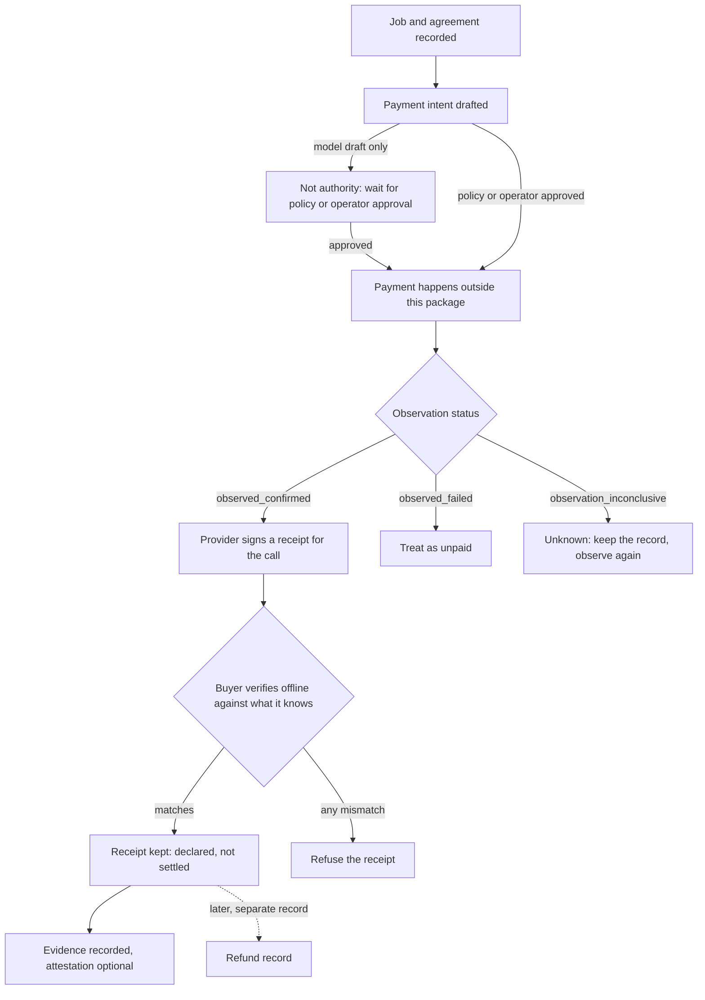

# RAP Interpretation Guide (interim)

Issue: [#679](https://github.com/nissan/reddi-agent-protocol/issues/679)

**Status: interim.** This guide describes what the code in this repository does today, at `@reddi/agent-protocol` 0.1.0 plus the unreleased receipt v2 changes. It is not the final guide. The final guide waits for the contract and version freeze tracked by ECO-041, ECO-044 and ECO-045, and for the two reviews listed under [Reviews still owed](#reviews-still-owed). Anything proposed, missing or undecided is marked **Not implemented** or **Proposed** where it appears.

Payments prove transfer; RAP Assurance proves paid work. This guide is about reading the records in between without mistaking one for the other.

## Who this is for and what it lets you do

| | |
|---|---|
| Audience | Protocol integrators, operators, reviewers and auditors. |
| Task goal | Given a RAP record, decide whether it authorises an action, records only an observation, requires a refusal or recovery step, or leaves the answer unknown. |
| Supported version | `@reddi/agent-protocol` 0.1.0 and the schema versions named in [Canonical sources](#canonical-sources). |
| Supported environments | Local and offline only: Node with a clean checkout. Every example runs from fixtures. |
| Prerequisites | `npm ci` in `packages/agent-protocol`. No wallet, key, RPC endpoint, provider account, hosted service or secret. |
| Owner | Not yet named. The issue records that an accountable RAP semantics owner and a docs owner are still to be accepted; this guide does not infer them. |

## The one rule

Each record answers one question. Never read a record as the answer to a later question.

| Step | Record | Schema | It tells you | It does not tell you |
|---|---|---|---|---|
| Agreement | Job and agreement records | `reddi.payment-job.v1`, `reddi.payment-agreement.v1` | What was asked and the terms both sides hashed. | That payment was intended or made. |
| Intent | Payment intent | `reddi.payment-intent.v1` | What payment is proposed, and who approved the proposal. | That a transaction was submitted. |
| Observation | Payment observation | `reddi.payment-observation.v1` | What a named verifier saw, where, and how sure it was. | That work was done, or that the payment cannot later be reversed. |
| Receipt | Provider-signed receipt | `reddi.receipt.v2` | That the provider's key signed a statement naming its wallet, the model it declares it served, the hashes of one request and one response, and one payment. | Which model actually ran, that the payment happened or is settled, work quality, custody or legal approval. |
| Work evidence | Evidence archive record | `reddi.evidence-archive.v1` | Hashes and pointers for what the specialist returned. | That the work was good. |
| Judgment | Attestation | `reddi.attestation.v1` | An attestor's verdict on one piece of evidence, and who the attestor was. | More than that attestor's opinion. A self-attested verdict is the seller's own word. |
| Refund | Refund record | `reddi.refund-record.v1` | That a refund was requested, approved, observed, failed or sent to manual review. | That money moved back, unless the state is `observed_confirmed`. |

`reddi.receipt.v2` is the only receipt this package accepts. `reddi.receipt.v1`, the buyer authority policy and the receipt and evidence binding were removed before V1 (owner decision, 20 November 2026). Buyer spend policy is not in this package; it is tracked in [#738](https://github.com/nissan/reddi-agent-protocol/issues/738).

Submission has no record of its own in this package. The package never submits a transaction and never holds a key: a receipt is signed through a function the provider supplies. An observation is the first record of anything happening on a payment rail.



In prose: a job and an agreement lead to a drafted intent. A model can draft an intent but cannot approve it. Payment itself happens outside this package. A verifier then records what it saw: confirmed, failed or inconclusive. The provider signs a receipt for the call, and the buyer checks it offline against the provider it chose, the bytes it sent and received and the payment it made. A receipt that matches says what the provider declared; it does not say the payment is settled. A refund is a later, separate record that leaves the receipt unchanged.

## Authority

**No spending authority lives in this package.** A catalog entry, a listing, discovery relevance and a discovery policy preflight are never authority to spend ([Discover / Decide / Prove boundaries](./DISCOVER-DECIDE-PROVE-BOUNDARIES.md)). The discovery preflight only says whether a candidate fits the buyer's stated source, trust, asset, network and price limits.

**Models.** A payment intent starts as `model_draft`. Every intent carries `modelMayAuthorize: false`, and changing it is rejected with `model_spend_authority_rejected`. An intent in state `operator_approved` must name the approval it relies on.

**Buyer spend policy. Not implemented here.** Caps, allowlists, expiry and revocation for a buyer's spending are tracked in [#738](https://github.com/nissan/reddi-agent-protocol/issues/738).

## Refusals and unknowns

A refusal is a result, not an error to retry around. Each one names the next safe action.

| You see | Meaning | Next safe action |
|---|---|---|
| Discovery preflight `allowed: false` with reason codes | The candidate does not fit the buyer's limits. | Fix the cause the code names, or choose another candidate. |
| `unsupported_version` | Not a `reddi.receipt.v2` receipt. | Reject it. |
| `malformed_receipt`, `malformed_proof`, `malformed_record` | The record is not the shape the schema requires, or carries a field the version does not define. | Reject it. Do not repair it by guessing. |
| `signature_invalid` | The signature does not verify against the provider named in the receipt. | Reject it. |
| `provider_mismatch` | Signed by a different provider than the one you chose. | Reject it. |
| `declared_model_mismatch` | The provider declares a different model than the one you asked for. | Reject it, or treat the call as not what was ordered. |
| `request_hash_mismatch`, `response_hash_mismatch` | The receipt is for different bytes than you sent or received. | Do not treat it as a receipt for this call. |
| `payment_mismatch` | The receipt names a different payment than the one you made. | Do not treat the call as covered by this receipt. |
| `credential_leakage_rejected` | An evidence record carries a secret-shaped field. | Remove the field at the source and re-create the record. |
| `observation_inconclusive` | The verifier could not tell. | Keep the record. Observe again later. It is neither paid nor failed. |
| `observed_failed` | The verifier saw the payment fail. | Treat as unpaid. |

A receipt can verify and still tell you little: checked with nothing to compare, a pass only says some key signed some statement (S2). Pass the provider you chose, the hashes of your own bytes and the payment you made.

## Environment labels

Every payment record carries two labels.

| Label | Values |
|---|---|
| `environment` | `deterministic-fixture`, `local-test-mint`, `devnet-unverified`, `mainnet-gated`, `controlled-live` |
| `eligibility` | `non_eligible`, `pending_partner_acceptance`, `eligible`, `excluded` |

Rules the validators enforce:

- Fixture, local and devnet evidence can never be `eligible` (`non_live_evidence_marked_eligible`).
- `mainnet-gated` and `controlled-live` evidence can be `eligible` only with a `partnerAcceptanceRef` (`mainnet_partner_acceptance_missing`). An observation alone is not partner acceptance.
- An AUDD record must carry the label of the rail its mint and network resolve to (`audd_rail_label_mismatch`, `audd_rail_identity_mismatch`). A devnet transfer cannot be relabelled as something else.

AUDD in this package is rail configuration and record metadata only. It is not custody and it is not settled escrow.

## Duplicates, replays and out-of-order records

- **Record ids are deterministic.** `deriveReddiPaymentId` hashes the canonical payload, so the same content always has the same id. Two records with one id are one record seen twice.
- **This package keeps no replay ledger.** Nothing in `@reddi/agent-protocol` remembers what it has seen. The consumer must compare ids.
- **The local evidence archive never replaces a stored record.** Putting the identical record again succeeds and changes nothing. Putting different content under an existing id is refused with `evidence_id_conflict`, and the first record stays (#724).
- **Nonce replay is checked in a different package.** `packages/x402-solana/src/nonce.ts` rejects a nonce it has already stored. Its default store is in memory and is lost on restart; the file says a persistent store is the caller's job.
- **Out-of-order detection. Not implemented.** No function orders records or flags a refund that arrives before its payment. A refund record must name its original observation by id, and that is the only link.
- **Reconciliation. Not implemented.** There is no reconciliation function. Until records agree, the honest status is unknown.

Issue #679 asks that a retry never erases the first observation. For the local evidence archive this holds since #724. A consumer's own store still has to enforce it.

## Refunds and reversals

- A refund is its own record with its own state: `requested`, `operator_approved`, `observed_confirmed`, `failed` or `manual_review`. Only `observed_confirmed`, with a `refundObservationId`, records a return transfer.
- A refund record does not change the original observation or the receipt.
- **A receipt has no revoked or contested state.** A receipt you hold may describe a payment that was later refunded; the receipt will not tell you.

To learn whether a payment still stands, look for refund records that name its observation, and ask the rail. Do not infer it from the receipt.

## Redaction

- A receipt carries only the fields its version defines: hashes, addresses, a model name and payment facts. A receipt with any other field, such as a prompt, is rejected (`malformed_receipt`).
- Evidence records reject credential-shaped keys and values, including values that merely look masked, and signature-shaped fields. Remove the field; do not mask it. Name a signed receipt in evidence by its hash.
- A redacted record can still be checked: compare the hash. It cannot be used to read the original content, and a matching hash says nothing about quality.

## What is not payment truth

None of these is settlement, partner acceptance or spending authority:

- A message on a transport such as Nostr, a webhook delivery or an HTTP 200.
- Anything shown in a user interface, dashboard or hosted page, including hosted discovery results.
- The state of a GitHub issue or pull request, or a line in a status document.
- A provider's or seller's own statement that it was paid or that the work is good.
- A drafted or approved payment intent.
- A receipt on its own.

The only record of a payment in this package is a payment observation from a named verifier, and even that records what was seen at a commitment level. It is not a statement that the payment is beyond reversal. Partner acceptance exists only as a `partnerAcceptanceRef` on a record's labels.

## Runnable examples

All examples are local, offline and no-spend.

```bash
cd packages/agent-protocol
npm ci
npm run example:interpretation-guide
```

The command prints one JSON document with a row per scenario: what the current code returned, what this guide says it returns, and whether they match. It exits 1 if any row no longer matches. `tests/interpretation-guide-scenarios.test.ts` runs the same script in `npm test`.

| Id | Scenario | Result today | Read it as |
|---|---|---|---|
| S1 | Signed receipt checked against what the buyer knows | verifies | Declared, not settled; not proof of which model ran. |
| S2 | Signed receipt checked with nothing to compare | verifies | Some key signed some statement. Always pass what you know. |
| S3 | Response is not the one that was signed | `response_hash_mismatch` | Not a receipt for this response. |
| S4 | Signed by a different provider than the one chosen | `provider_mismatch` | Refuse. |
| S5 | Receipt edited after signing | `signature_invalid` | Refuse. |
| S6 | Receipt names a different payment | `payment_mismatch` | The call is not covered by this receipt. |
| S7 | A removed receipt version | `unsupported_version` | Only `reddi.receipt.v2` is accepted. |
| S8 | Receipt with a field the version does not define | `malformed_receipt` | Rejected, not ignored. |
| S9 | Devnet evidence labelled eligible | `non_live_evidence_marked_eligible` | Refuse the label. |
| S10 | Mainnet evidence labelled eligible without partner acceptance | `mainnet_partner_acceptance_missing` | Refuse the label. |
| S11 | Same payload derived twice | same id | One record seen twice. |
| S12 | Same id stored twice: identical, then different | one record kept; the different one refused with `evidence_id_conflict` | A retry cannot erase the first record. |
| S13 | Refund requested | valid; state `requested`; no refund observation | Money has not moved back. |
| S14 | Verifier could not conclude | valid; `observation_inconclusive` | Durable unknown; observe again. |
| S15 | Model-drafted intent, then edited to claim model authority | `model_draft`; edit rejected with `model_spend_authority_rejected` | A draft is a proposal. |

Coverage against the issue's list: success (S1, S2), safe refusal (S3 to S7), wrong environment (S9, S10), duplicate and replay (S11, S12), refund (S13), redaction (S8), unavailable dependency (S14). Missing-evidence and card-rail reversal scenarios left with the modules that were removed.

The wider end-to-end walk-through is `npm run example:ard:no-spend`, described in the [developer quickstart](./RAP-V0.1-DEVELOPER-QUICKSTART-AND-CONFORMANCE.md).

## Canonical sources

This guide explains; these files define. Where they differ, the file wins and this guide is wrong.

| Subject | Source | Tests |
|---|---|---|
| Receipt | `packages/agent-protocol/src/receipt-v2.ts` | `tests/receipt-v2.test.ts` |
| Job, agreement, intent, observation, refund, labels | `src/payment-records.ts`, `src/audd-rail-config.ts` | `tests/payment-records.test.ts` |
| Evidence archive | `src/evidence-archive.ts` | `tests/evidence-archive.test.ts` |
| Attestation | `src/attestation-reputation.ts` | `tests/attestation-reputation.test.ts` |
| Nonce replay | `packages/x402-solana/src/nonce.ts` | that package's tests |
| What public copy may claim | [`PUBLIC-CLAIM-BOUNDARY.md`](./PUBLIC-CLAIM-BOUNDARY.md) | `npm run check:claims:public` |
| Lane boundaries | [`DISCOVER-DECIDE-PROVE-BOUNDARIES.md`](./DISCOVER-DECIDE-PROVE-BOUNDARIES.md) | |

## Limitations

- **Interim.** Written before the ECO-041, ECO-044 and ECO-045 freeze. Schema names and reason codes may change.
- **Not implemented today:** buyer spend policy, a replay ledger in this package, out-of-order detection, reconciliation, and a revoked or contested receipt state.
- **Proposed elsewhere and deliberately left out:** vouchers, deferred redemption and settlement reconciliation in [#691](https://github.com/nissan/reddi-agent-protocol/issues/691) and [#693](https://github.com/nissan/reddi-agent-protocol/issues/693). Nothing in this guide describes them as shipped.
- **Undecided and not decided here:** the open no-SPL versus SPL contract question.
- **Fixtures only.** Every example uses maintained fixtures. Nothing here was run against a live rail, and nothing here is a production-readiness claim.
- **No measured benefit.** No reader has yet been timed or scored against this guide.

## Reviews still owed

Issue #679 requires a clean-reader review and a RAP owner review before the guide is final. Neither has happened. The builder's own review of this guide is not a substitute for either.

| Review | State |
|---|---|
| Clean reader: classify the scenarios and record confusing terms | Not done |
| RAP semantics owner: correctness and acceptance of freshness responsibility | Not done; owner not yet named |

## Freshness triggers

Review this guide after any of these:

- A version change to a receipt, payment record, evidence or attestation schema.
- A new or changed adapter capability, environment label or redaction rule.
- A change to replay or verifier behaviour.
- A newly supported rail.
- A row in `npm run example:interpretation-guide` that stops matching. That is the built-in alarm.
- The ECO-041, ECO-044 and ECO-045 freeze, which replaces this interim guide with the final one.
