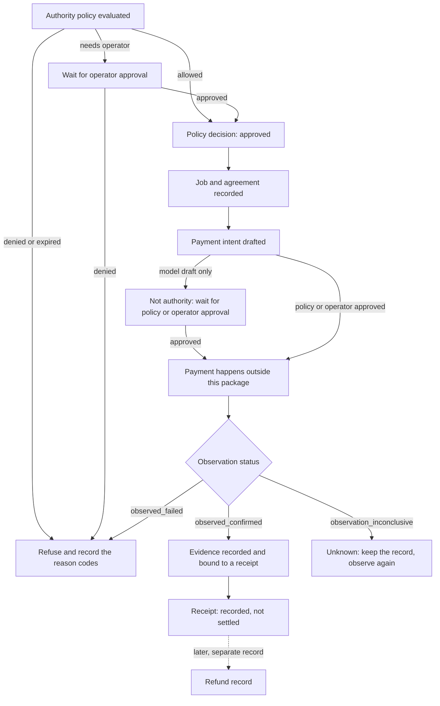

# RAP Interpretation Guide (interim)

Issue: [#679](https://github.com/nissan/reddi-agent-protocol/issues/679)

**Status: interim.** This guide describes what the code in this repository does today, at `@reddi/agent-protocol` 0.1.0. It is not the final guide. The final guide waits for the contract and version freeze tracked by ECO-041, ECO-044 and ECO-045, and for the two reviews listed under [Reviews still owed](#reviews-still-owed). Anything proposed, missing or undecided is marked **Not implemented** or **Proposed** where it appears.

Payments prove transfer; RAP Assurance proves paid work. This guide is about reading the records in between without mistaking one for the other.

## Who this is for and what it lets you do

| | |
|---|---|
| Audience | Protocol integrators, operators, reviewers and auditors. |
| Task goal | Given a RAP record, decide whether it authorises an action, records only an observation, requires a refusal or recovery step, or leaves the answer unknown. |
| Supported version | `@reddi/agent-protocol` 0.1.0 and the schema versions named in [Canonical sources](#canonical-sources). |
| Supported environments | Local and offline only: Node with a clean checkout. Every example runs from fixtures. |
| Prerequisites | `npm ci` in `packages/agent-protocol`. No wallet, key, RPC endpoint, provider account, hosted service or secret. |
| Owner | Not yet named. The issue records that an accountable RAP semantics owner and a docs owner are still to be accepted; this guide does not infer them. |

## The one rule

Each record answers one question. Never read a record as the answer to a later question.

| Step | Record | Schema | It tells you | It does not tell you |
|---|---|---|---|---|
| Permission | Buyer authority policy and its evaluation | `reddi.buyer-authority-policy.v1` | Whether this buyer may ask this seller for this amount on this rail, now. | That anything was signed, sent or paid. |
| Decision | Policy decision | `reddi.policy-decision.v1` | Allow, deny or needs operator approval, with reason codes. | That the allowed action happened. |
| Agreement | Job and agreement records | `reddi.payment-job.v1`, `reddi.payment-agreement.v1` | What was asked and the terms both sides hashed. | That payment was intended or made. |
| Intent | Payment intent | `reddi.payment-intent.v1` | What payment is proposed, and who approved the proposal. | That a transaction was submitted. |
| Observation | Payment observation | `reddi.payment-observation.v1` | What a named verifier saw, where, and how sure it was. | That work was done, or that the payment cannot later be reversed. |
| Work evidence | Evidence archive record | `reddi.evidence-archive.v1` | Hashes and pointers for what the specialist returned. | That the work was good. |
| Judgment | Attestation status on the receipt | part of `reddi.receipt.v1` | Whether a judgment was requested and how it ended. | Anything, when the status is `not_requested` or `pending`. |
| Receipt | Receipt | `reddi.receipt.v1` | That one workflow recorded a policy decision, a payment-proof reference, request and response hashes and an evidence pointer. | Settlement, mainnet execution, work quality, custody or legal approval. |
| Binding | Receipt and evidence binding | `reddi.receipt-evidence-binding.v1` | That the receipt, evidence, payment plan and any observation agree with each other. | More than its parts tell you. |
| Refund | Refund record | `reddi.refund-record.v1` | That a refund was requested, approved, observed, failed or sent to manual review. | That money moved back, unless the state is `observed_confirmed`. |

Signing and submission have no record of their own in this package. The package never signs or submits; an observation is the first record of anything happening on a payment rail.



In prose: authority is checked first and can refuse, allow or ask for an operator. An allowed request leads to a job, an agreement and a drafted intent. A model can draft an intent but cannot approve it. Payment itself happens outside this package. A verifier then records what it saw: confirmed, failed or inconclusive. Only a confirmed observation can be bound to a receipt. A receipt says the workflow was recorded; it does not say the payment is settled. A refund is a later, separate record that leaves the receipt unchanged.

## Authority

**Source.** Authority comes from a `BuyerAuthorityPolicy` that names the buyer agent. `evaluateBuyerAuthorityPolicy` is the only function that turns it into an allow or a refusal. Catalog entries, listings and discovery relevance are never authority ([Discover / Decide / Prove boundaries](./DISCOVER-DECIDE-PROVE-BOUNDARIES.md)).

**Scope.** A policy allows only the listed rails, currencies, sellers and endpoints, up to the spend cap, in the listed support states. Anything outside is refused with a reason code: `unsupported_rail_currency`, `seller_not_allowlisted`, `spend_cap_exceeded`. Every policy carries `allowLivePayment: false`, `forbidCustody: true` and `forbidSettlementFinality: true`; a policy that says otherwise is refused (`live_payment_rejected`, `custody_claim_rejected`, `settlement_finality_claim_rejected`).

**Expiry.** A request made after `expiresAt` is refused with `policy_expired`. Payment intents and agreements carry their own `quoteExpiresAt` and `expiresAt`.

**Revocation. Not implemented.** The policy has no revoked state and no revocation list. The only ways to withdraw authority today are to let the policy expire or to replace it with one whose mode is `deny`. Do not assume a policy you hold has not been replaced; ask the issuer.

**Operator approval.** When a policy requires approval, the request is refused with `operator_approval_required` until the approval state is `approved`, and with `operator_approval_denied` if it was denied.

**Models.** A payment intent starts as `model_draft`. Every intent carries `modelMayAuthorize: false`, and changing it is rejected with `model_spend_authority_rejected`. An intent in state `operator_approved` must name the approval it relies on.

## Refusals and unknowns

A refusal is a result, not an error to retry around. Each one names the next safe action.

| You see | Meaning | Next safe action |
|---|---|---|
| `allowed: false` with reason codes | Authority refused the request. | Fix the cause the code names, or stop. |
| `policy_expired` | The authority is out of date. | Get a fresh policy from the buyer or operator. |
| `operator_approval_required` | A person has not approved yet. | Wait for the operator. Do not proceed on a draft. |
| `evidence_requirement_missing`, `receipt_requirement_missing` | Required proof was not presented. | Obtain the missing evidence or receipt. |
| `payment_proof_missing` | The receipt names no payment proof. | Treat the job as unpaid. |
| `malformed_receipt`, `malformed_record` | The record is not the shape the schema requires. | Reject it. Do not repair it by guessing. |
| `unsupported_network_asset` | The rail is outside the v1 allowlist. | Wait for adapter support. |
| `credential_leakage_rejected`, `raw_payload_leakage_rejected` | The record carries a secret-shaped or raw-content field. | Remove the field at the source and re-create the record. |
| `observation_inconclusive` | The verifier could not tell. | Keep the record. Observe again later. It is neither paid nor failed. |
| `observed_failed` | The verifier saw the payment fail. | Treat as unpaid. |
| Proof-chain status `blocked` | A fixture or rail cannot be bound, with a failure code. | Read the failure code; do not route around it. |
| `attestationStatus` of `not_requested` or `pending` | No judgment exists yet. | Do not report the work as judged. |

A receipt can be valid and still record a refusal: the `policyDenial` fixture validates, and its policy decision has `allowed: false`. "The receipt validated" and "the work was allowed" are different statements.

## Environment labels

Every payment record carries two labels.

| Label | Values |
|---|---|
| `environment` | `deterministic-fixture`, `local-test-mint`, `devnet-unverified`, `mainnet-gated`, `controlled-live` |
| `eligibility` | `non_eligible`, `pending_partner_acceptance`, `eligible`, `excluded` |

Rules the validators enforce:

- Fixture, local and devnet evidence can never be `eligible` (`non_live_evidence_marked_eligible`).
- `mainnet-gated` and `controlled-live` evidence can be `eligible` only with a `partnerAcceptanceRef` (`mainnet_partner_acceptance_missing`). An observation alone is not partner acceptance.
- An AUDD record must carry the label of the rail its mint and network resolve to (`audd_rail_label_mismatch`, `audd_rail_identity_mismatch`). A devnet transfer cannot be relabelled as something else.
- A binding refuses an observation whose labels do not match where it was observed (`payment_observation_ineligible`).

AUDD in this package is payment-plan and proof metadata only. It is not custody and it is not settled escrow.

## Duplicates, replays and out-of-order records

- **Record ids are deterministic.** `deriveReddiPaymentId` hashes the canonical payload, so the same content always has the same id. Two records with one id are one record seen twice.
- **This package keeps no replay ledger.** Nothing in `@reddi/agent-protocol` remembers what it has seen. The consumer must compare ids.
- **The local evidence archive never replaces a stored record.** Putting the identical record again succeeds and changes nothing. Putting different content under an existing id is refused with `evidence_id_conflict`, and the first record stays (#724).
- **Nonce replay is checked in a different package.** `packages/x402-solana/src/nonce.ts` rejects a nonce it has already stored. Its default store is in memory and is lost on restart; the file says a persistent store is the caller's job.
- **Out-of-order detection. Not implemented.** No function orders records or flags a refund that arrives before its payment. A refund record must name its original observation by id, and that is the only link.
- **Reconciliation. Not implemented.** There is no reconciliation function. Until records agree, the honest status is unknown.

Issue #679 asks that a retry never erases the first observation. For the local evidence archive this holds since #724. A consumer's own store still has to enforce it.

## Refunds and reversals

- A refund is its own record with its own state: `requested`, `operator_approved`, `observed_confirmed`, `failed` or `manual_review`. Only `observed_confirmed`, with a `refundObservationId`, records a return transfer.
- A refund record does not change the original observation or the receipt.
- **Receipt v1 has no revoked or contested state.** This is a known gap tracked in [#338](https://github.com/nissan/reddi-agent-protocol/issues/338). A receipt you hold may describe a payment that was later refunded or reversed; the receipt will not tell you.
- Card-rail refund, dispute and reversal events are refused as receipts (`revocable_event_rejected`). The card-rail receipt shape is capped at `probe_only` for this reason.

To learn whether a payment still stands, look for refund records that name its observation, and ask the rail. Do not infer it from the receipt.

## Redaction

- Receipts, evidence records and bindings reject credential-shaped keys and values, including values that merely look masked. Remove the field; do not mask it.
- Bindings reject raw prompt, output and transcript fields. Records carry hashes and pointers instead.
- A redacted record can still be checked: compare the hash. It cannot be used to read the original content, and a matching hash says nothing about quality.

## What is not payment truth

None of these is settlement, partner acceptance or spending authority:

- A message on a transport such as Nostr, a webhook delivery or an HTTP 200.
- Anything shown in a user interface, dashboard or hosted page, including hosted discovery results.
- The state of a GitHub issue or pull request, or a line in a status document.
- A provider's or seller's own statement that it was paid or that the work is good.
- A drafted or approved payment intent.
- A receipt on its own.

The only record of a payment in this package is a payment observation from a named verifier, and even that records what was seen at a commitment level. It is not a statement that the payment is beyond reversal. Partner acceptance exists only as a `partnerAcceptanceRef` on a record's labels.

## Runnable examples

All examples are local, offline and no-spend.

```bash
cd packages/agent-protocol
npm ci
npm run example:interpretation-guide
```

The command prints one JSON document with a row per scenario: what the current code returned, what this guide says it returns, and whether they match. It exits 1 if any row no longer matches. `tests/interpretation-guide-scenarios.test.ts` runs the same script in `npm test`.

| Id | Scenario | Result today | Read it as |
|---|---|---|---|
| S1 | Authority allows the request | `allowed: true`, `buyer_authority_policy_valid` | Permission only. |
| S2 | Valid receipt for allowed work | validates; decision allowed | Recorded, not settled. |
| S3 | Valid receipt that records a denial | validates; decision not allowed | Valid shape, refused work. |
| S4 | Authority expired | `policy_expired` | Refuse; get a fresh policy. |
| S5 | Operator approval still required | `operator_approval_required` | Refuse; wait for the operator. |
| S6 | Required evidence not presented | `evidence_requirement_missing` | Refuse; obtain the evidence. |
| S7 | Receipt without a payment-proof reference | `payment_proof_missing` | Not a receipt; unpaid. |
| S8 | Devnet evidence labelled eligible | `non_live_evidence_marked_eligible` | Refuse the label. |
| S9 | Mainnet evidence labelled eligible without partner acceptance | `mainnet_partner_acceptance_missing` | Refuse the label. |
| S10 | Receipt on an unsupported network and asset | `unsupported_network_asset` | Refuse; wait for adapter support. |
| S11 | Same payload derived twice | same id | One record seen twice. |
| S12 | Same id stored twice: identical, then different | one record kept; the different one refused with `evidence_id_conflict` | A retry cannot erase the first record. |
| S13 | Refund requested | valid; state `requested`; no refund observation | Money has not moved back. |
| S14 | Card-rail reversal event | `revocable_event_rejected` | Not a receipt; the earlier receipt is unchanged. |
| S15 | Credential-shaped metadata | `credential_leakage_rejected` | Remove the field. |
| S16 | Proof-chain fixture | `binding_ready`; no raw prompt or output stored | Checkable by hash only. |
| S17 | Verifier could not conclude | valid; `observation_inconclusive` | Durable unknown; observe again. |
| S18 | Rail the receipt contract does not cover | `blocked` | Wait; do not route around it. |
| S19 | Model-drafted intent, then edited to claim model authority | `model_draft`; edit rejected with `model_spend_authority_rejected` | A draft is a proposal. |

Coverage against the issue's list: success (S1, S2), safe refusal (S3 to S5), missing evidence (S6, S7), wrong environment (S8 to S10), duplicate and replay (S11, S12), refund and reversal (S13, S14), redaction (S15, S16), unavailable dependency (S17, S18).

The wider end-to-end walk-through is `npm run example:ard:no-spend`, described in the [developer quickstart](./RAP-V0.1-DEVELOPER-QUICKSTART-AND-CONFORMANCE.md).

## Canonical sources

This guide explains; these files define. Where they differ, the file wins and this guide is wrong.

| Subject | Source | Tests |
|---|---|---|
| Receipt and policy decision | [`RAP-RECEIPT-POLICY-V1.md`](./RAP-RECEIPT-POLICY-V1.md), `packages/agent-protocol/src/receipts.ts`, `policy.ts`, `fixtures.ts` | `tests/receipts.test.ts` |
| Buyer authority | `src/buyer-authority-policy.ts` | `tests/buyer-authority-policy.test.ts` |
| Job, agreement, intent, observation, refund, labels | `src/payment-records.ts`, `src/audd-rail-config.ts` | `tests/payment-records.test.ts` |
| Evidence archive | `src/evidence-archive.ts` | `tests/evidence-archive.test.ts` |
| Receipt and evidence binding | `src/receipt-evidence-binding.ts` | `tests/receipt-evidence-binding.test.ts` |
| Rail-neutral receipts and proof chain | `src/rail-neutral-payment-receipts.ts`, `src/rail-neutral-proof-chain-fixture.ts` | `tests/rail-neutral-payment-receipts.test.ts`, `tests/rail-neutral-proof-chain-fixture.test.ts` |
| Card-rail reversal handling | `src/airwallex-webhook-receipt-normalization.ts` | `tests/airwallex-webhook-receipt-normalization.test.ts` |
| Nonce replay | `packages/x402-solana/src/nonce.ts` | that package's tests |
| What public copy may claim | [`PUBLIC-CLAIM-BOUNDARY.md`](./PUBLIC-CLAIM-BOUNDARY.md) | `npm run check:claims:public` |
| Lane boundaries | [`DISCOVER-DECIDE-PROVE-BOUNDARIES.md`](./DISCOVER-DECIDE-PROVE-BOUNDARIES.md) | |

## Limitations

- **Interim.** Written before the ECO-041, ECO-044 and ECO-045 freeze. Schema names and reason codes may change.
- **Not implemented today:** authority revocation, a replay ledger in this package, out-of-order detection, reconciliation, and a revoked or contested receipt state.
- **Proposed elsewhere and deliberately left out:** vouchers, deferred redemption and settlement reconciliation in [#691](https://github.com/nissan/reddi-agent-protocol/issues/691) and [#693](https://github.com/nissan/reddi-agent-protocol/issues/693). Nothing in this guide describes them as shipped.
- **Undecided and not decided here:** the open no-SPL versus SPL contract question.
- **Fixtures only.** Every example uses maintained fixtures. Nothing here was run against a live rail, and nothing here is a production-readiness claim.
- **No measured benefit.** No reader has yet been timed or scored against this guide.

## Reviews still owed

Issue #679 requires a clean-reader review and a RAP owner review before the guide is final. Neither has happened. The builder's own review of this guide is not a substitute for either.

| Review | State |
|---|---|
| Clean reader: classify the scenarios and record confusing terms | Not done |
| RAP semantics owner: correctness and acceptance of freshness responsibility | Not done; owner not yet named |

## Freshness triggers

Review this guide after any of these:

- A version change to a receipt, policy decision, authority, payment record, evidence or binding schema.
- A new or changed adapter capability, environment label or redaction rule.
- A change to replay or verifier behaviour.
- A newly supported rail.
- A row in `npm run example:interpretation-guide` that stops matching. That is the built-in alarm.
- The ECO-041, ECO-044 and ECO-045 freeze, which replaces this interim guide with the final one.
