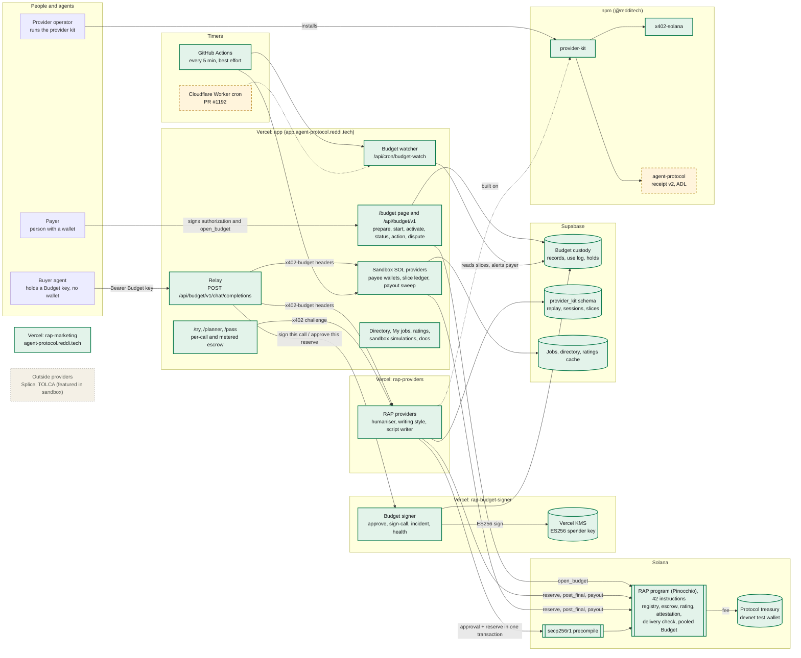
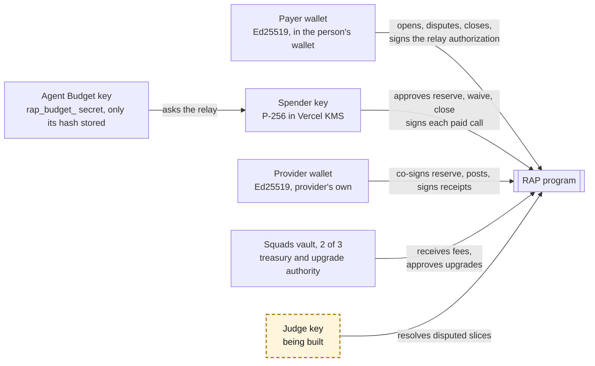

# 01 System architecture (as built, devnet)

Everything that moves money ends in one on-chain program. Around it sit four Vercel projects, one Supabase project,
two timers and three npm packages. This page is the layout running on devnet today (main at the end of 26 November
2026). [02](02-mainnet-target-layout.md) is the layout mainnet Budgets need.

## The pieces

| Piece | Where | Job |
|---|---|---|
| RAP program | `programs/pinocchio-escrow/` | One Pinocchio program, one build, 42 instructions. Holds every lock; pays providers, the treasury and refunds. Devnet program `DcfW3Cxt…5Ucu`. |
| App | repo root, Vercel project `reddi-agent-protocol` | The Budget page and its routes, the relay agents call, the Budget watcher, the devnet sandbox providers, the per-call pages, directory, My jobs. Holds no KMS grant. |
| Budget signer | `apps/budget-signer/`, Vercel `rap-budget-signer` | The only project granted the KMS issuer. Re-checks the payer's signed authorization, holds, limits and the use log before every signature. |
| RAP providers | `apps/providers/`, Vercel `rap-providers` | RAP's own providers on the provider kit (serverless), state in the `provider_kit` schema. |
| Marketing | `apps/marketing/`, Vercel `rap-marketing` | The public site. |
| Supabase | `supabase/migrations/` | Custody records (`budget_spenders`, `budget_spender_uses`, `budget_signer_holds`), the provider kit's state, app data. |
| Timers | `.github/workflows/budget-watch.yml`, `ops/budget-watch-worker/` (PR #1192) | Call the watcher and the sandbox payout sweep every 5 minutes. GitHub's schedule is best effort, so a Cloudflare Worker is being added. |
| npm packages | `packages/x402-solana`, `packages/provider-kit`, `packages/agent-protocol` | x402 challenge, escrow and Budget builders; the runnable provider server; receipt v2, ADL and the offline checks. |

## Who holds which key

The relay holds no spender key material: the private key never leaves KMS, and the signer project alone may ask for a
signature. The agent never holds a wallet, only a key that lets it ask the relay to spend within what the payer
signed. On devnet the treasury is a plain test wallet; on mainnet it is the Squads vault.
