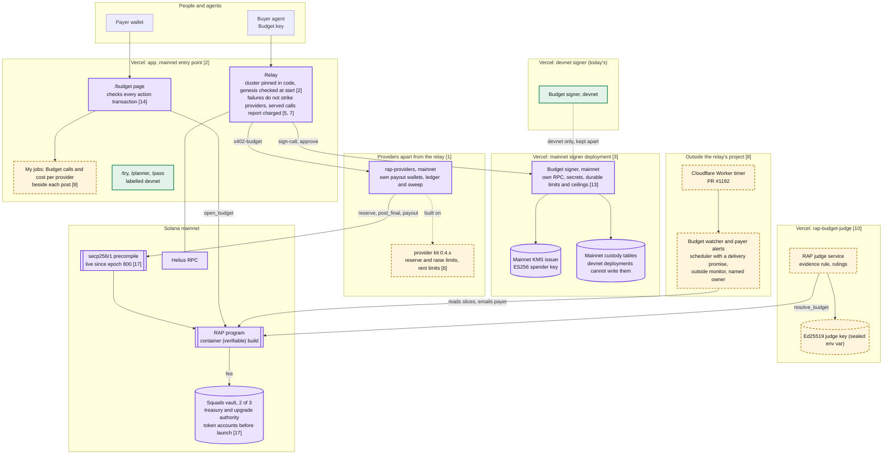
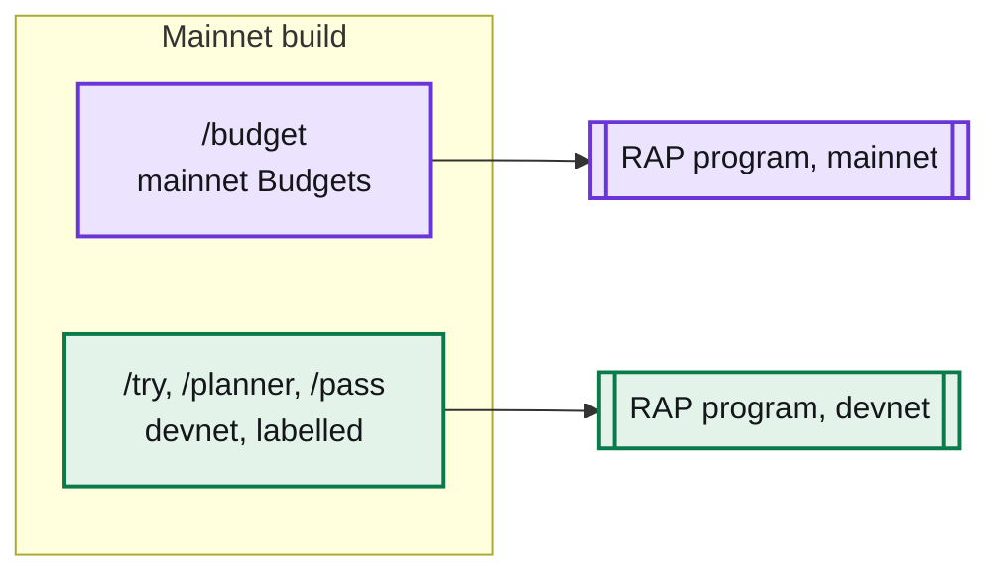

# 02 Mainnet target layout (Budgets, 5 December launch)

The launch puts Budgets on mainnet; per-call payments stay on devnet. The final security round (26 November, at
1079ce8) found the devnet layout fine for test funds but not for relay-held Budgets with real money: the app project
holds the sandbox providers' payee wallets, their ledger, the payout cron and the watcher next to the relay. The target
below takes each of those out. Numbers in brackets are the tasks on issue #1157; colours follow the
[status key](README.md#status-key).

## What moves, and why

| Today (devnet) | Target (mainnet) | Why | #1157 |
|---|---|---|---|
| Sandbox SOL providers' payee wallets, slice ledger and payout sweep live in the app project | No provider wallet, ledger or payout job in the relay's project; no scripted sandbox provider in the mainnet directory | A compromised relay must not also be a provider that can post and collect | 1 |
| One codebase reads devnet constants | A mainnet entry point with the cluster pinned in code; each deployment checks its RPC's genesis hash at start | No path can serve one cluster with the other's settings | 2 |
| One signer deployment, devnet | A second signer deployment with its own KMS issuer, key, RPC, secrets and tables | A devnet leak cannot sign or write for mainnet | 3 |
| Watcher runs in the app project on a best-effort GitHub schedule | Watcher and payer alerts outside the relay's project, on a scheduler with a delivery promise and an outside monitor (PR #1192 starts this with a Cloudflare Worker timer) | The payer's dispute window only helps if the alert arrives | 8 |
| No judge set by default | RAP judge in its own project with a KMS key, or a stated no-judge launch | A dispute needs someone who can rule within 72 hours | 10 |
| Treasury is a devnet test wallet | Squads vault `5CsBuTBF…3Hxe` (2 of 3) receives fees and holds upgrade authority | No single key can take fees or change the program | 17 |

The rest of the list keeps the launch caps (0.5 SOL or 100 USDC per Budget, provider share at most half), rehearses
the incident step on a mainnet build (pause, close all, resume, unfreeze, KMS grant removal), gives payers a way to
freeze a leaked agent key and close or pay out without the app, and ends with a review of the mainnet entry point at
its own commit. The code on main still refuses Budgets on mainnet (`lib/budget/runtime.ts`) until those are done.

## Per-call stays on devnet

Owner decision, 26 November 2026: pre-spend Budgets lead because people set a budget first and the agent spends inside
it. Direct per-call and per-escrow payments ([03](03-per-call-x402.md), [04](04-metered-escrow.md)) keep working on
devnet while their pricing and demand are worked out; the `/updates` page says so and why.
