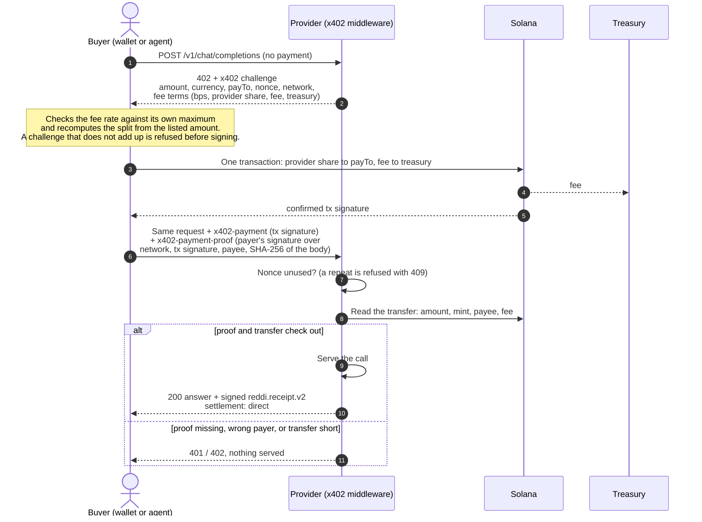

# 03 Per-call x402 payment (devnet only at launch)

The simplest way to pay: one call, one transfer. The provider answers `402 Payment Required` with a challenge, the
buyer's wallet pays the listed price in one transaction (the provider's share and the protocol fee together), and the
buyer repeats the request with proof that it is the wallet that paid. Currencies: SOL, USDC, AUDD, PYUSD and USDG.
At launch this path runs on devnet only ([02](02-mainnet-target-layout.md#per-call-stays-on-devnet)).

## Why the proof header

A confirmed transfer is public. Without a proof, anyone who saw the buyer's payment could present it first and be
served, and the buyer would then be refused as a duplicate. So the request carries a signature by the wallet that
paid, over this network, this transaction, this payee and this request body. A browser wallet can sign once to hand the
provider a short-lived session key (`x402-payment-delegation`), so it does not prompt on every call.

## Money

| | |
|---|---|
| Buyer pays | The listed price, nothing on top |
| Provider gets | The price less the protocol fee |
| Treasury gets | The fee: planned 5%, 2.5% launch rate for payouts before 1 April 2027 UTC, rounded down, capped at 0.1 SOL on SOL payments |
| Measured on devnet `/try` | About $0.04 a call, about 6% network fee, about 4 seconds end to end |

Code: `buildDirectPaymentInstructions` and `directPaymentProofHeaders` in `packages/x402-solana`
(`direct-payment.ts`, `direct-auth.ts`); `checkAndStoreNonce` for replay.
