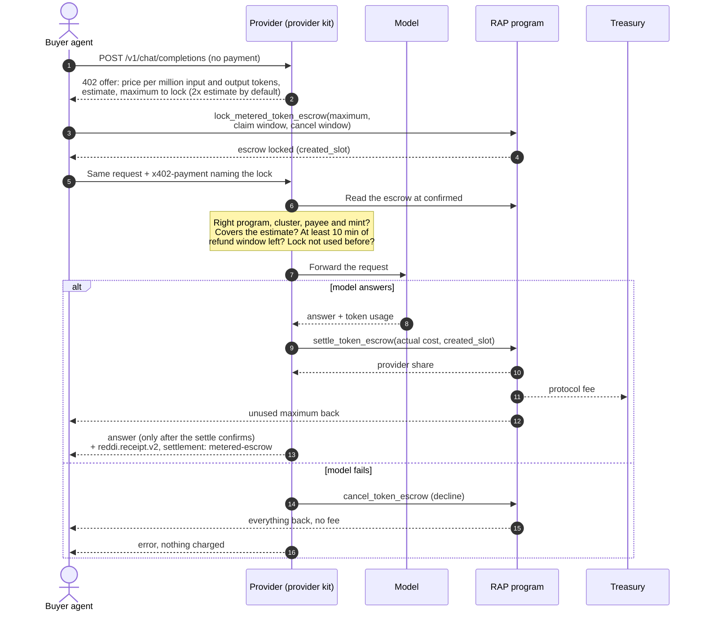
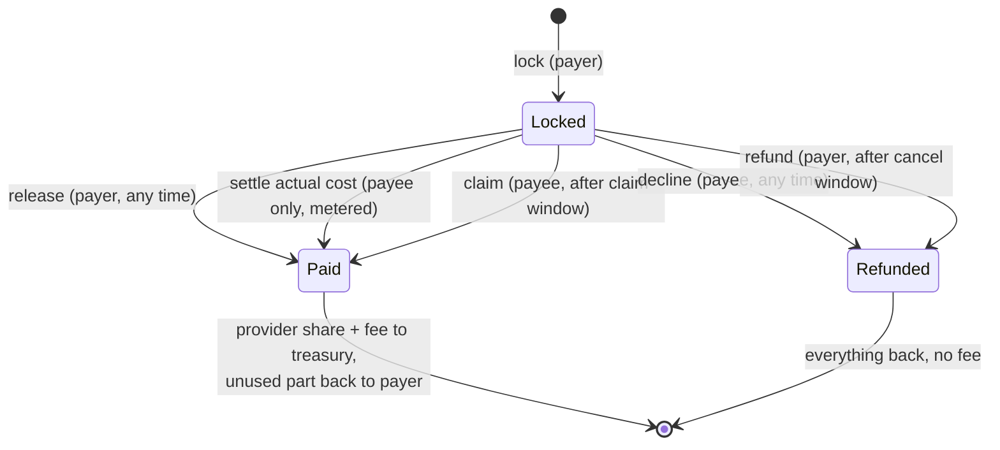
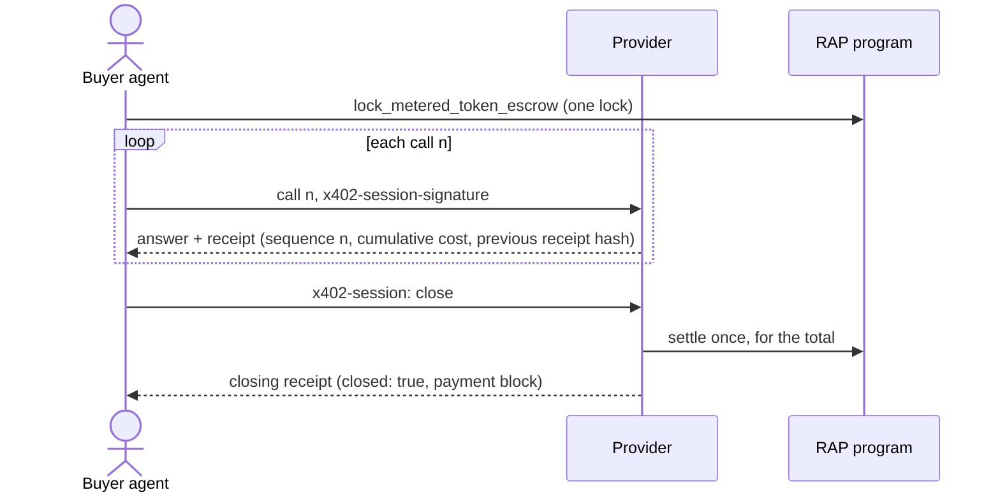
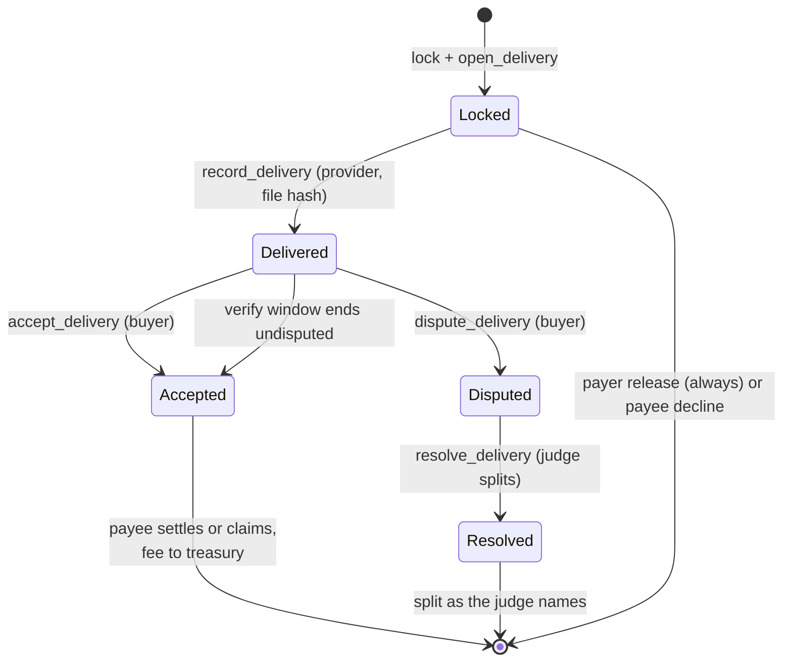

# 04 Metered escrow (per-token calls)

For a call priced per token, the buyer cannot know the cost up front. So it locks a maximum in the RAP program, the
provider serves, and the provider settles the **actual** cost: the program pays the provider, sends the fee to the
treasury and returns the rest to the buyer, all in one transaction. At launch this runs on devnet
([02](02-mainnet-target-layout.md#per-call-stays-on-devnet)).

The buyer is charged only after the model answered, and gets the answer only after the settle confirmed. The charge is
tokens used times the price, rounded up to the smallest unit, and never more than the lock.

## Who can end an escrow

Every exit names its escrow by `created_slot` and cannot land in the lock slot, so an exit signed for one job can never
end a later job at the same address. Caps: 0.5 SOL or 100 token units per escrow.

## Sessions: many calls, one settle

An agent that makes many small calls to one provider locks once and numbers its calls (`x402-session-sequence: 1, 2,
3…`), each signed by a session key its wallet delegated once. Every answer carries a receipt whose `session` block
holds the running totals and the hash of the previous receipt, so the buyer can check the chain. The provider settles
once, for the total, on close, when the lock is used up, after an idle time, or before the refund window opens.

## Delivery check (fixed-price media jobs)

A media job (a video, an image) can opt in to a delivery check at lock (escrow bit `0x04`). The provider records the
delivery, the buyer gets a verify window to accept or dispute, and a judge named at lock splits a disputed job. The
payee collects only after the buyer accepts or the window ends undisputed; the buyer can always release in full. The
chain cannot fetch the file: it records what the payee says it delivered (units, bytes, SHA-256), and the buyer's agent
or the judge checks the file against the receipt's `delivery` block.

Code: `@redditech/x402-solana/provider` (`verifyMeteredLock`, `meteredSettlement`), `packages/provider-kit`; program
README "Delivery check".
