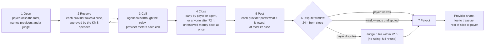
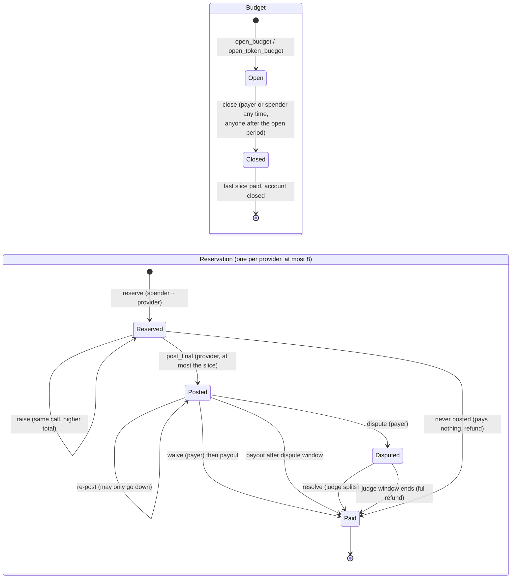
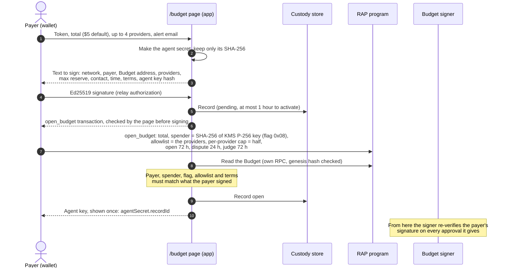
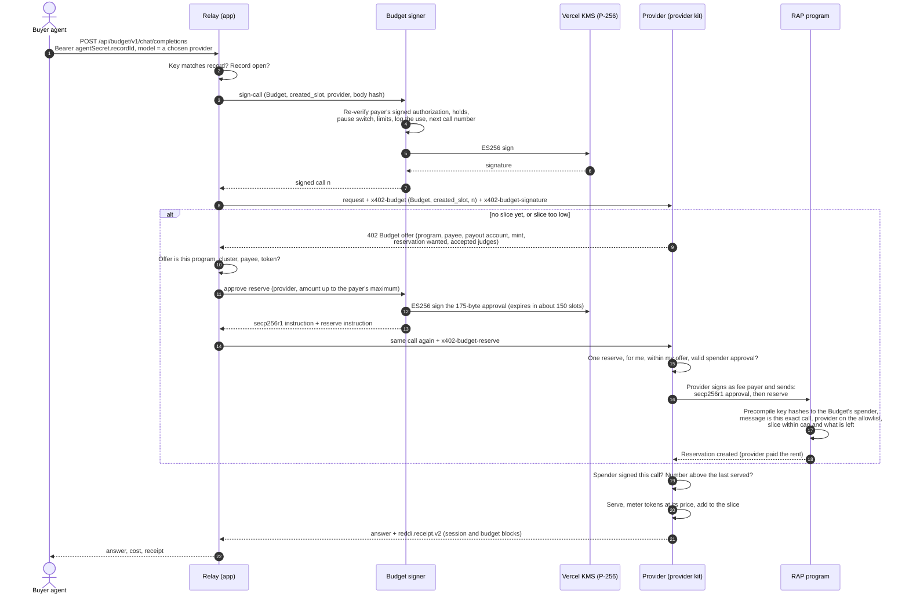
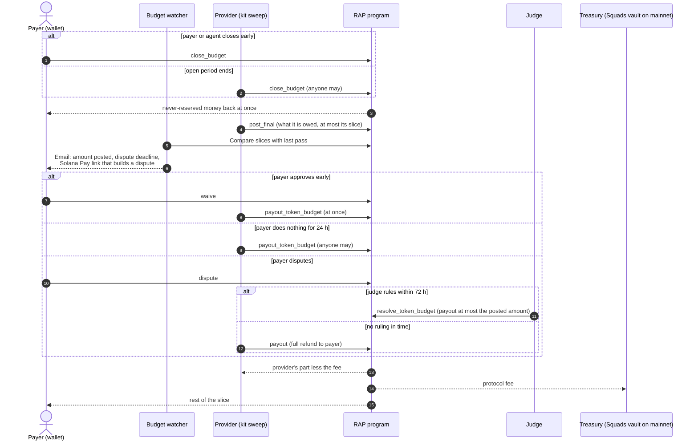

# 05 Budget lifecycle

A Budget is one lock that pays several providers. A person locks a total (for example $5 in USDC) for an open period
(72 hours by default), and their agent gets a **key, not a wallet**. While the Budget is open the agent calls providers
through the RAP relay; each provider reserves its own **slice** on chain, serves calls against it, posts what it is
owed, and is paid after a 24-hour dispute window. What was never reserved, and what a slice did not use, goes back to
the payer. Budgets are the launch product on mainnet ([02](02-mainnet-target-layout.md)); everything below runs on
devnet today (devnet end-to-end runs passed on 25 and 26 November).

## The whole life on one page

## Accounts and their states

## 1 Open: the payer sets it up

## 2 and 3 Reserve and call: the agent spends

The agent never touches a wallet. It sends an OpenAI-style request to the relay with its Budget key. The relay asks
the signer to sign the call; on a provider's first call (or when a slice runs low) it asks the signer to approve a
reserve, and the provider co-signs and pays for the reserve transaction.

Limits on the relay's path (each over 10 minutes): 30 approvals per Budget, 60 per payer, 300 per network; 300 paid
calls per Budget, 600 per payer, 6,000 per network. Past the per-Budget limit the Budget is frozen and the operator is
told. A reserve is approved only for a provider the payer named and only up to the payer's signed maximum.

## 4 to 7 Close, post, dispute window, payout

The dispute window runs from the close (from the end of the open period at the earliest when someone other than the
payer closed a Budget without an allowlist) and never ends sooner than about an hour after the provider's first post. A
re-post may only lower the amount.

## Fees on a payout

The fee comes out of the provider's part, never on top: planned 5%, with a 2.5% launch rate for payouts before
1 April 2027 UTC, rounded down, capped at 0.1 SOL on SOL Budgets only.

| Example (devnet run, 26 November) | Lamports |
|---|---|
| Slice posted by the provider | 700 |
| Fee at the 2.5% launch rate (17.5, rounded down) | 17 to the treasury |
| Provider receives | 683 |
| Rest of the slice and never-reserved money | back to the payer |

The planned launch bonus (#1115) adds to this on mainnet USDC Budgets for 30 days after launch: a Budget earns a bonus
of half its total with RAP's own providers. The bonus covers a third of each such call and the slice is charged the
rest (the fee is taken on the charged part only), up to $10 per wallet from a $1,000 pool. It is a discount recorded
by RAP's providers, so no extra money moves, and it stays off until its start date is set.

## Recording the work

A Budget call becomes a job in My jobs only when a landed `payout_budget` or `resolve_budget` (or its token form) for
this Budget, this opening and this provider's reservation is found, with the amounts from the program's own `BudgetPaid`
event, and the provider's signed receipt v2 names the same Budget and reservation (`lib/jobs/budget-call.ts`). Showing
calls and cost per provider beside each post is in flight (#1145).

## When something goes wrong

The operator's incident step runs in the signer, never through the app: pause every approval, close every open Budget
on chain with a KMS approval (never-reserved money goes back at once; posted slices keep their dispute window), then,
if needed, remove the KMS grant so nothing can approve again. A payer can always close their own Budget from their
wallet. Detail: [`BUDGET-RELAY-CUSTODY.md`](../BUDGET-RELAY-CUSTODY.md#incident-the-relay-or-its-kms-access-may-be-compromised).
