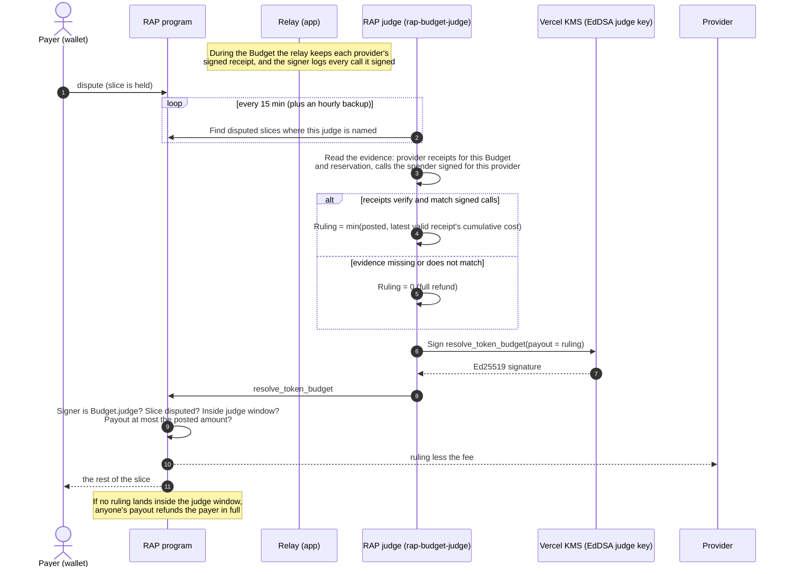
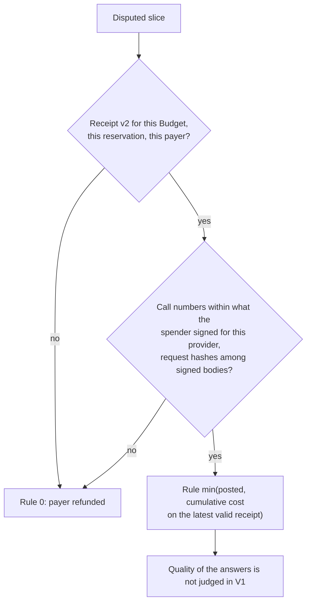

# 06 Budget judge (being built)

A payer who disputes a posted slice needs someone to rule. The program already supports it: `resolve_budget` and
`resolve_token_budget` accept a signature from the judge the Budget named at open, on a disputed slice, before the
judge window ends (72 hours by default), paying the provider at most what it posted. A slice nobody rules on in time is
refunded to the payer in full. What is being built is the RAP-run judge that sits behind that key (#1157 task 10). The
decisions below are the recommended design, waiting on the owner; nothing here is deployed.

## What the judge decides, and what it does not

| Decision (recommended, awaiting the owner) | |
|---|---|
| Evidence rule | Pay what signed receipts and signed calls prove was served, never more than posted |
| Key custody | A Vercel KMS EdDSA key granted only to its own project, `rap-budget-judge`, one per network; the judge pays its own fees |
| Missing evidence | Full refund to the payer |
| Timing | Evidence window 24 hours; automatic ruling well inside the 72-hour judge window |

Providers must list the judge in `budgets.acceptedJudges`: a provider kit with an empty list refuses any Budget that
names a judge. So the default judge, the sandbox desk, `rap-providers` and featured providers change in the same step.
