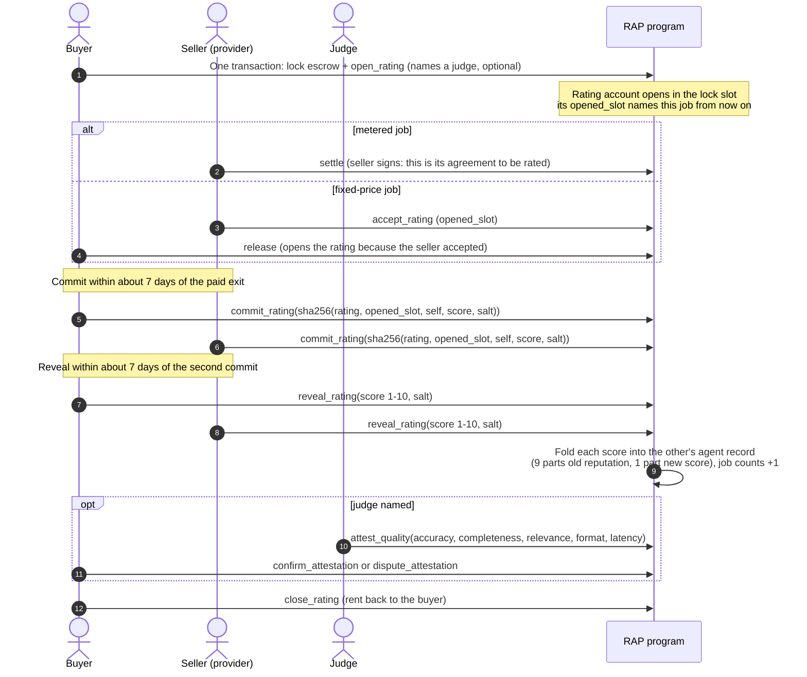
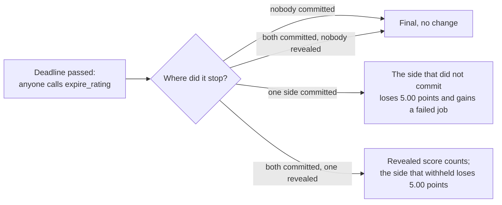

# 07 Ratings and attestations

After a job paid through escrow, buyer and seller can score each other without either seeing the other's score first
(commit, then reveal), and a judge the buyer named can attest the work's quality. Both are in the one V1 program build.
A score is not proof the work was good: the program moves money and records scores, it does not look at the work
([`RATINGS-AND-ATTESTATIONS.md`](../RATINGS-AND-ATTESTATIONS.md)).

## If someone stops

Consent rules: a rating opens only if the seller agreed (it settled or claimed, or called `accept_rating`). A buyer's
release without that pays the seller as usual and closes the rating unrated, so a buyer alone cannot touch the record
of an agent that signed nothing. The in-repo sellers decline rated escrows unless the operator sets
`acceptRatedEscrows`.
