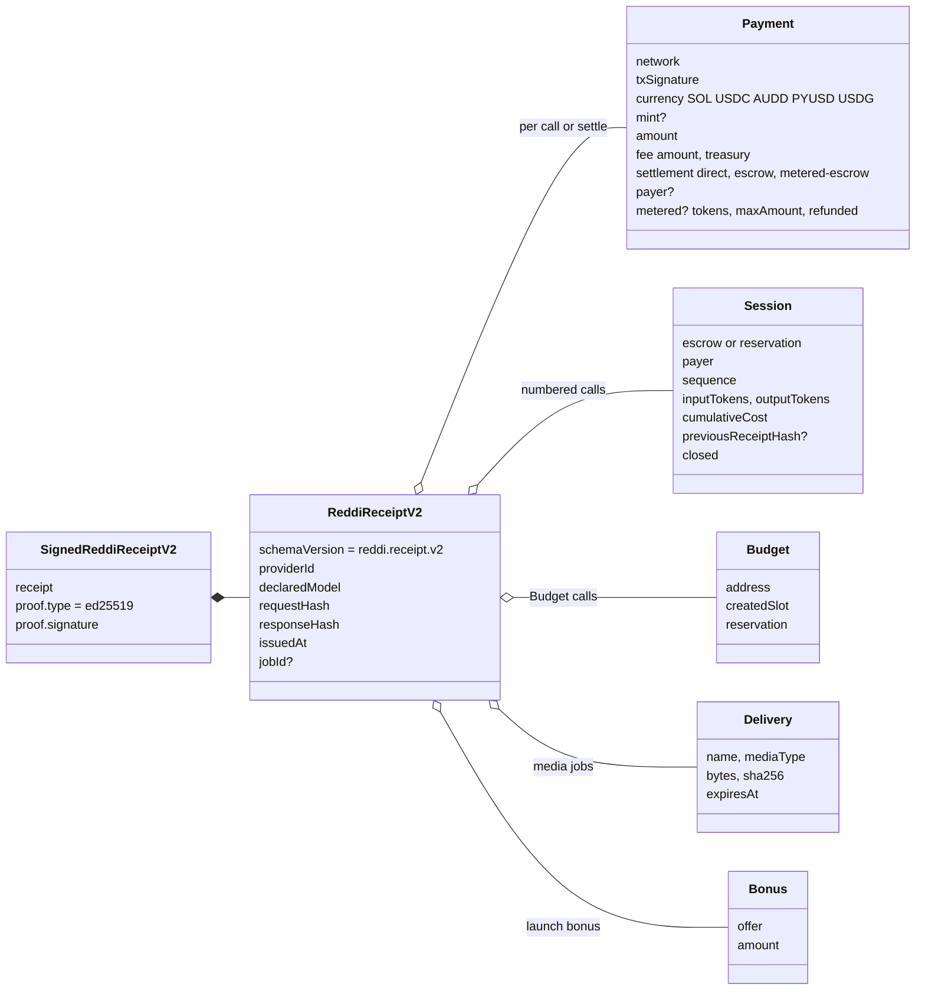
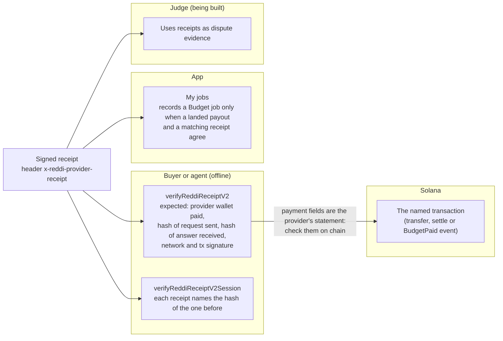

# 08 Receipts v2

Every paid call in V1 ends with a `reddi.receipt.v2`: a statement the provider signs with its own wallet key (Ed25519
over a fixed-order canonical form) saying what it was asked, what it answered, which model it declared and how it was
paid. Payments prove transfer; the receipt binds that transfer to the work. Verification is offline, against what the
buyer knows itself.

## Who checks it, and against what

A valid signature shows what the provider declared. It does not show which model ran, and the payment fields are only
the provider's word until the named transaction is read on chain. `reddi.receipt.v2` is the only version accepted; v1
was removed before V1 (#776). Code: `packages/agent-protocol/src/receipt-v2.ts`.
