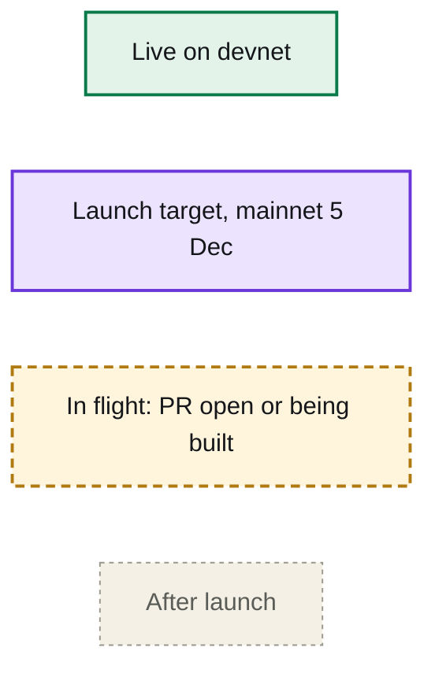

# Reddi Agent Protocol architecture and flows

These pages draw how the Reddi Agent Protocol (RAP) fits together: the one on-chain program, the Vercel projects, the
store, the npm packages, and the money flows that run between them. Each page is a Mermaid diagram (GitHub renders it)
plus the few sentences it needs. They are the baseline for the marketing versions of the same diagrams, so they name
the real pieces and the real rules, and they mark what is live on devnet, what is the 5 December launch target and
what is still being built.

Owner decision, 26 November 2026: the launch has **Budgets on mainnet**. Direct per-call payments (`/try`, `/planner`,
`/pass`) stay on **devnet** while their pricing and demand are worked out. The protocol fee is planned (5%, with a 2.5%
launch rate for payouts before 1 April 2027 UTC) until a mainnet release collects it
([`PUBLIC-CLAIM-BOUNDARY.md`](../PUBLIC-CLAIM-BOUNDARY.md)).

| Page | What it shows |
|---|---|
| [01 System architecture](01-system-architecture.md) | Every moving piece as built today (devnet) and how they talk |
| [02 Mainnet target layout](02-mainnet-target-layout.md) | The layout for mainnet Budgets, with what is in flight marked against #1157 |
| [03 Per-call x402 payment](03-per-call-x402.md) | A direct payment for one call (devnet only at launch) |
| [04 Metered escrow](04-metered-escrow.md) | Lock the maximum, pay the actual cost; sessions; the delivery check |
| [05 Budget lifecycle](05-budget-lifecycle.md) | Open, reserve slices, agent calls through the relay and signer, close, post, dispute window, payout, fees |
| [06 Budget judge](06-budget-judge.md) | How a disputed slice gets a ruling (being built) |
| [07 Ratings and attestations](07-rating-attestation.md) | Commit and reveal scores after an escrow job; the judge's attestation |
| [08 Receipts v2](08-receipts-v2.md) | What a `reddi.receipt.v2` holds and who checks it |
| [Image prompts](image-prompts.md) | Prompts for the marketing versions of these diagrams (logged, not yet run) |

## Status key

Diagrams colour their nodes the same way everywhere:

## Sources

The diagrams follow the code and these documents; when they disagree, the code and these win:

- [`programs/pinocchio-escrow/README.md`](../../programs/pinocchio-escrow/README.md): the program's 42 instructions,
  windows, accounts and the P-256 spender.
- [`BUDGET-RELAY-CUSTODY.md`](../BUDGET-RELAY-CUSTODY.md): relay, signer, KMS, watcher, limits and the incident step.
- [`PAYMENT-FLOW-ARCHITECTURE.md`](../PAYMENT-FLOW-ARCHITECTURE.md) and
  [`ESCROW-PAYOUT-SAFETY.md`](../ESCROW-PAYOUT-SAFETY.md): x402 semantics and escrow windows.
- [`RATINGS-AND-ATTESTATIONS.md`](../RATINGS-AND-ATTESTATIONS.md): ratings and judge attestations.
- [`packages/provider-kit/README.md`](../../packages/provider-kit/README.md),
  [`packages/x402-solana/README.md`](../../packages/x402-solana/README.md) and
  [`packages/agent-protocol/README.md`](../../packages/agent-protocol/README.md): the npm packages and receipt v2.
- Issue #1157 (mainnet Budgets) and its task list from the final security round.

When a flow changes, change its diagram in the same pull request.
